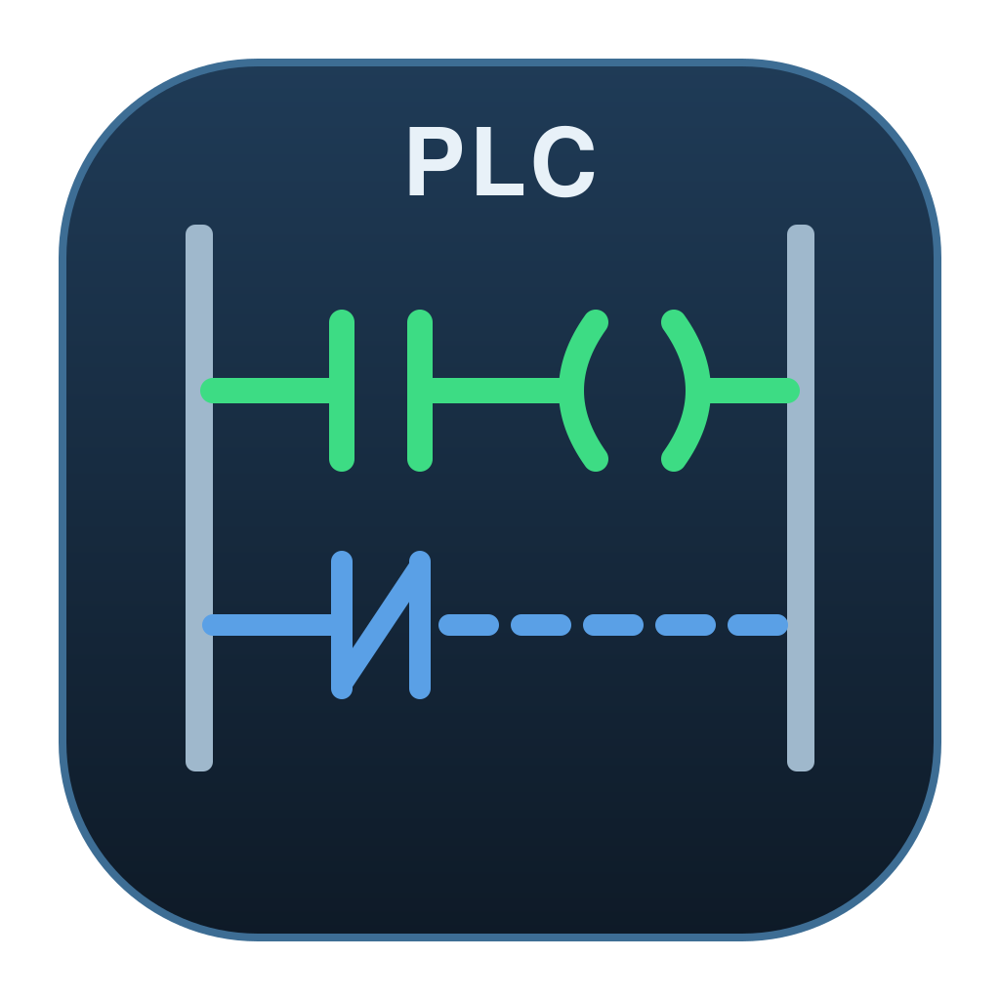
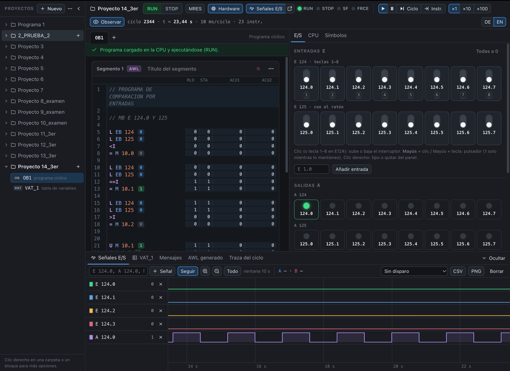
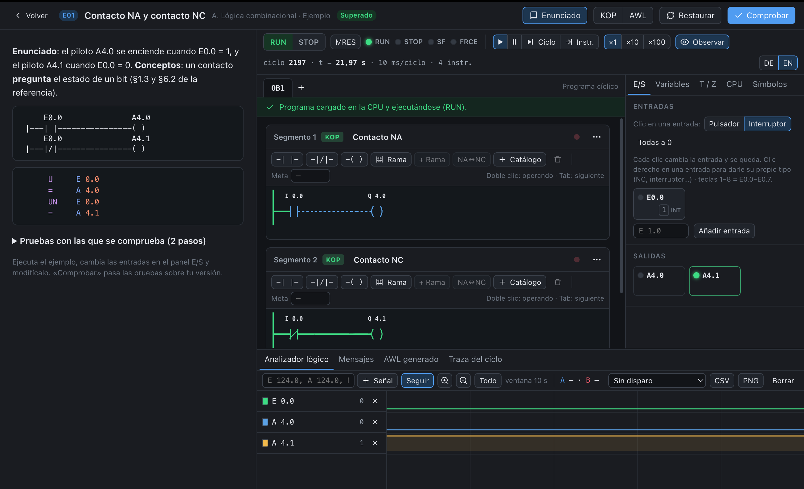
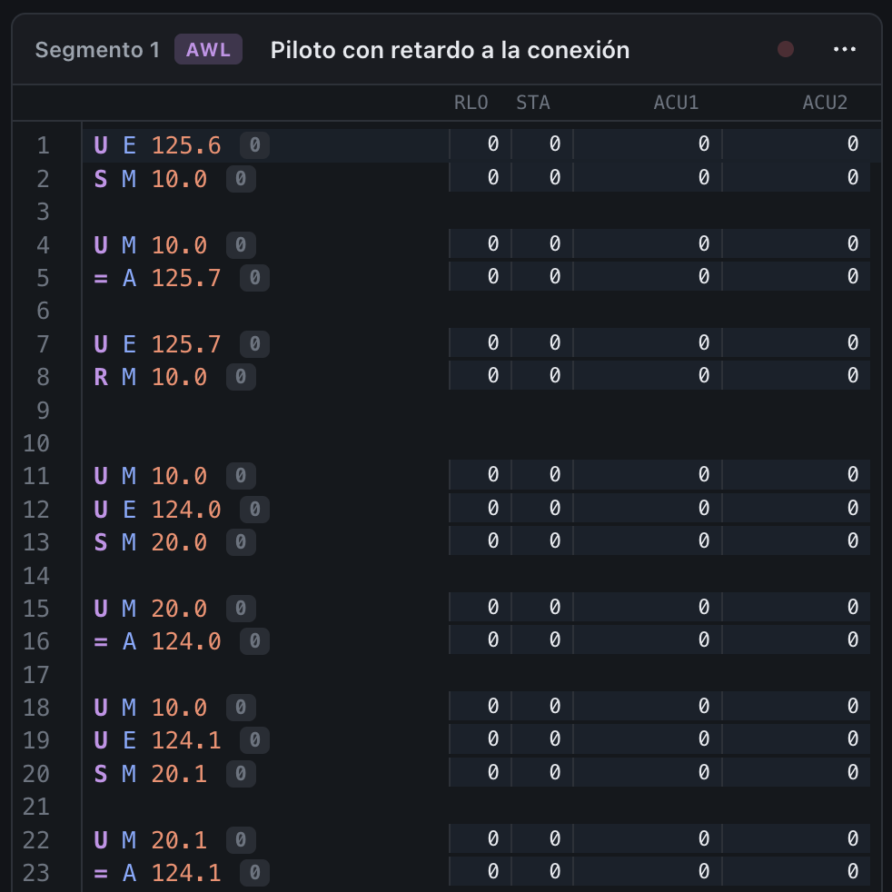
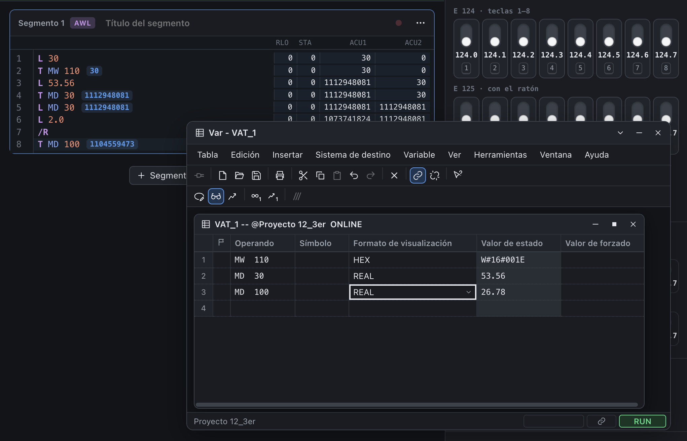
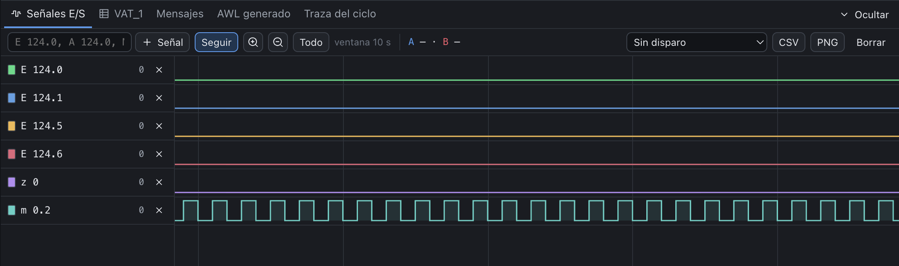

<p align="center">
  
</p>

<h1 align="center">Automatizacion</h1>

<p align="center">
  <b>Simulador de PLC gratuito para aprender a programar autómatas en KOP (Ladder) y AWL (STL).</b><br>
  Para macOS, Windows y Linux (con Wine). En español, inglés y alemán. Sin hardware, sin licencias y sin conexión.
</p>

<p align="center">
  <a href="https://github.com/Nicarayzon/plc-ladder-stl-simulator/releases/latest"></a>
  
  
</p>

<p align="center">
  <a href="https://nicarayzon.github.io/plc-ladder-stl-simulator/"><b>Web del proyecto</b></a> ·
  <a href="#funciones">Funciones</a> ·
  <a href="#instalación">Instalación</a> ·
  <a href="#compilar-desde-el-código">Compilar</a> ·
  <a href="#contacto">Contacto</a>
</p>

> **English:** free desktop PLC simulator to learn Ladder (KOP/LAD) and Statement List (AWL/STL) programming. Available in English, Spanish and German (interface, theory and examples; change it in Settings ▸ Language). Code can be written with English or German mnemonics.

<p align="center">
  
</p>

## Qué es

Automatizacion es un simulador de autómatas programables para tu ordenador. Programas en **KOP** (esquema de contactos o Ladder) y en **AWL** (lista de instrucciones o STL), pulsas RUN y ves cómo la CPU recorre el ciclo de scan, cuenta los temporizadores y enciende las salidas.

Trae la teoría completa y 31 ejemplos resueltos que se ejecutan, para estudiar y practicar en el mismo sitio. Está pensado para:

- **Preparar exámenes de autómatas** (FP de Automatización y Robótica Industrial, Mantenimiento Electromecánico, ingeniería), con el RLO y los acumuladores a la vista.
- **Probar un programa antes del laboratorio**, con direcciones reales como `E 124.0` o `A 124.0`.
- **Explicar en clase** el ciclo de scan, el flujo de corriente y los cronogramas.
- **Iniciarse en la automatización industrial** por tu cuenta.

## Funciones

**Programación**
- **Editor KOP:** contactos NA y NC, bobinas, ramas en paralelo y catálogo de elementos, también con teclas (<kbd>F2</kbd>, <kbd>F3</kbd>, <kbd>F7</kbd>…). En RUN, el cable con corriente se ve verde y continuo.
- **Editor AWL** por segmentos, con resaltado de sintaxis, autocompletado y errores marcados mientras escribes.
- **«Observar»:** junto a cada línea AWL, el RLO, el STA, el ACU1 y el ACU2; junto a cada operando, su valor en ese momento.
- Nemotécnica **alemana** (`U`, `E`, `A`) o **inglesa** (`A`, `I`, `Q`), con el botón DE/EN.
- Cada segmento KOP se traduce a un AWL equivalente, que puedes consultar.

**La CPU simulada**
- RUN, STOP y MRES; ciclo a ciclo o instrucción a instrucción; a ×1, ×10 o ×100.
- CPU de dos acumuladores con palabra de estado, temporizadores, contadores, saltos y aritmética.
- Bloques OB1, funciones FC y OB100 de arranque.
- **Marca de ciclo** activable en «Hardware», en el byte que elijas (de 0,1 s a 2 s).

**Entradas, salidas y señales**
- Entradas como **interruptores de palanca** y salidas como **pilotos**: `E 124.0`–`E 125.7` y `A 124.0`–`A 125.7` siempre a la vista, más las que use tu programa.
- `E 124.0`–`E 124.7` también con las teclas <kbd>1</kbd>–<kbd>8</kbd>. Con <kbd>Mayús</kbd>, la entrada funciona como **pulsador**: vale 1 solo mientras la mantienes.
- **Marcas** agrupadas por byte, con sus ocho bits en fila.
- **Cronograma de señales** (analizador lógico): seguimiento en tiempo real, zoom, cursores A y B para medir Δt, disparo y exportación a CSV o PNG. Se puede abrir en otra ventana para llevarlo a otro monitor.
- **Tabla de variables** para observar y forzar, con formatos BOOL, BIN, HEX, DEC, REAL, S5TIME, TIME y CHAR. Flota sobre el código o se acopla abajo.

**Aprender y practicar**
- **Teoría** por capítulos, con índice y buscador: ciclo de scan, áreas de memoria, tipos de datos, bloques, KOP, AWL, equivalencias entre los dos, errores típicos y trampas de examen.
- **31 ejemplos resueltos**, agrupados por temas y con pruebas: «Comprobar» pasa las pruebas sobre tu versión.
- **En español, inglés y alemán:** la interfaz, los menús, la teoría y los ejemplos. La primera vez se abre en el idioma del sistema y se cambia en «Ajustes ▸ Idioma».

**Tus proyectos**
- Cada proyecto es una carpeta con sus bloques y sus tablas de variables.
- Renombra, duplica y exporta proyectos (`.json`) o su fuente AWL (`.awl`), e impórtalos en otro equipo.
- Todo se guarda en tu ordenador: sin cuentas y sin conexión.

## Capturas

<table>
  <tr>
    <td width="50%"></td>
    <td width="50%"></td>
  </tr>
  <tr>
    <td>Un ejemplo en RUN: enunciado, segmentos KOP y entradas y salidas.</td>
    <td>«Observar» en AWL: RLO, STA y acumuladores línea a línea.</td>
  </tr>
  <tr>
    <td></td>
    <td></td>
  </tr>
  <tr>
    <td>La tabla de variables, encima del código.</td>
    <td>El cronograma de señales, con la marca de ciclo.</td>
  </tr>
</table>

El recorrido completo, pantalla a pantalla, está en la [web del proyecto](https://nicarayzon.github.io/plc-ladder-stl-simulator/#funciones).

## Instalación

Los instaladores están en la [web del proyecto](https://nicarayzon.github.io/plc-ladder-stl-simulator/#descargar) y en [Releases](https://github.com/Nicarayzon/plc-ladder-stl-simulator/releases/latest).

| Sistema | Fichero | Notas |
|---|---|---|
| macOS con Apple Silicon (M1 o posterior) | `.dmg` | Abre el `.dmg` y arrastra Automatizacion a Aplicaciones. No funciona en Mac con procesador Intel. |
| Windows 10 y 11 de 64 bits | Instalador `.exe` o portable `.zip` | El portable no se instala: descomprímelo y abre `Automatizacion.exe`. |
| Linux | El `.exe` o el `.zip` de Windows, con [Wine](https://www.winehq.org/) | No hay versión nativa. Probado en Arch Linux con Wine 11.19. |

**La primera vez que la abres**, el sistema avisa porque la app no está firmada por Apple ni por Microsoft:

- **macOS:** abre *Ajustes del Sistema → Privacidad y seguridad* y pulsa *«Abrir igualmente»* junto al aviso de Automatizacion. También puedes ejecutar en el Terminal:
  ```sh
  xattr -dr com.apple.quarantine /Applications/Automatizacion.app
  ```
- **Windows:** en el aviso de SmartScreen, pulsa *«Más información»* y luego *«Ejecutar de todas formas»*.

**Para actualizar**, usa el menú *Automatizacion ▸ Buscar actualizaciones…* (en Windows, *Ayuda ▸ Buscar actualizaciones…*), disponible desde la 0.22.0. Tus proyectos se conservan: están en `~/Library/Application Support/Automatizacion` (macOS) o en `%APPDATA%\Automatizacion` (Windows). La app solo se conecta a internet cuando le pides buscar actualizaciones.

## Cómo funciona por dentro

En cada ciclo, la CPU simulada hace lo mismo que un autómata real:

1. **Temporizadores:** avanzan según el tiempo de ciclo.
2. **Lee entradas:** la periferia se copia a la imagen de entradas.
3. **Ejecuta el OB1** (y el OB100 en el primer ciclo tras pasar a RUN).
4. **Escribe salidas:** la imagen de salidas pasa a los pilotos.

El motor está escrito en **TypeScript** (`src/core/`). Es una máquina de estados reanudable, por eso se puede avanzar instrucción a instrucción. El editor KOP compila cada segmento a AWL y los dos lenguajes se ejecutan en el mismo motor. Para que el resultado sea el correcto, las pruebas lo comparan con un intérprete de referencia en Python (`tools/interprete_referencia.py`) sobre miles de programas aleatorios: memoria, temporizadores, contadores, acumuladores, palabra de estado y traza tienen que coincidir.

Hecho con [Electron](https://www.electronjs.org/), [React](https://react.dev/), [Vite](https://vite.dev/) y [CodeMirror](https://codemirror.net/); las pruebas, con [Vitest](https://vitest.dev/) y [Playwright](https://playwright.dev/).

## Compilar desde el código

Necesitas [Node.js](https://nodejs.org/) 22.12 o posterior. Python 3.9+ con PyYAML solo hace falta para la prueba diferencial y el intérprete de referencia.

```sh
git clone https://github.com/Nicarayzon/plc-ladder-stl-simulator.git
cd plc-ladder-stl-simulator
npm install
npm run build        # comprueba los tipos y compila la interfaz en dist/
npm run electron     # abre la app compilada
```

Para desarrollar con recarga en caliente, deja `npm run dev` en una terminal y, en otra (macOS o Linux):

```sh
VITE_DEV_SERVER_URL=http://localhost:5173 npm run electron
```

Pruebas:

```sh
npm test              # núcleo, KOP y equivalencias (Vitest)
npm run test:diff     # el motor frente al intérprete de referencia, con programas aleatorios
npx playwright test   # de extremo a extremo, sobre la app compilada (después de npm run build)
```

`npm run dist` genera el instalador de macOS (Apple Silicon) en `release/`.

### Estructura del repositorio

| Carpeta | Contenido |
|---|---|
| `src/core/` | Motor: compilador AWL, CPU, temporizadores, contadores y traducción DE ↔ EN |
| `src/kop/` | Editor KOP: modelo, dibujo, flujo de corriente y compilación a AWL |
| `src/sim/` | Bucle en tiempo real, entradas y salidas, forzado y analizador |
| `src/ui/` | Interfaz: banco de trabajo, editores, paneles y pantallas |
| `src/content/` | Teoría («Aprender») y ejemplos resueltos |
| `electron/` | Proceso principal: ventana, menús y búsqueda de actualizaciones |
| `tests/` | Pruebas con Vitest (`core/`, `kop/`) y Playwright (`e2e/`) |
| `tools/` | Intérprete de referencia en Python |
| `docs/` | Web del proyecto (GitHub Pages) |

Más detalle en [`00_LEEME.md`](00_LEEME.md) y en la especificación de partida, [`03_especificacion_simulador.md`](03_especificacion_simulador.md).

## Contacto

Hecho por **Adrian**, Ing. de Datos en Procesos Industriales ([@Nicarayzon](https://github.com/Nicarayzon) en GitHub).

¿Tienes una duda, una idea o un programa que quieras enseñar? Escribe en [Discussions](https://github.com/Nicarayzon/plc-ladder-stl-simulator/discussions).

¿Has encontrado un fallo? Abre una [incidencia](https://github.com/Nicarayzon/plc-ladder-stl-simulator/issues) e indica tu sistema, la versión de la app (sale en la barra lateral) y los pasos para reproducirlo. Si el problema está en un programa, pega también su código AWL.

## Licencia

[MIT](LICENSE) © 2026 Arzath.

Proyecto educativo independiente, sin relación con ningún fabricante de autómatas.
